# دليل صاحب الاستوديو — إدارة محتوى الموقع

الدخول: https://sultan-records.vercel.app/login ← البريد وكلمة المرور ← رمز تطبيق التحقق (Authenticator).
كل ما يخص الموقع موجود في القائمة الجانبية تحت **«محتوى الموقع»**. أي تغيير تنشره يظهر في الموقع خلال ثوانٍ، **بدون** الحاجة لأي تحديث أو نشر برمجي.

قاعدة عامة لكل الشاشات:
- **حفظ مسودة**: يحفظ بدون ما يظهر للزوار.
- **معاينة**: تشوف الشكل قبل النشر.
- **نشر**: يظهر للزوار. **إخفاء**: يختفي عنهم بدون حذف.
- لو طلعت من صفحة فيها تعديلات غير محفوظة، الموقع يحذّرك.
- الترتيب: اسحب العنصر بالإصبع أو الماوس، أو استعمل أزرار ↑ ↓.

## تعديل معلومات النشاط والرئيسية
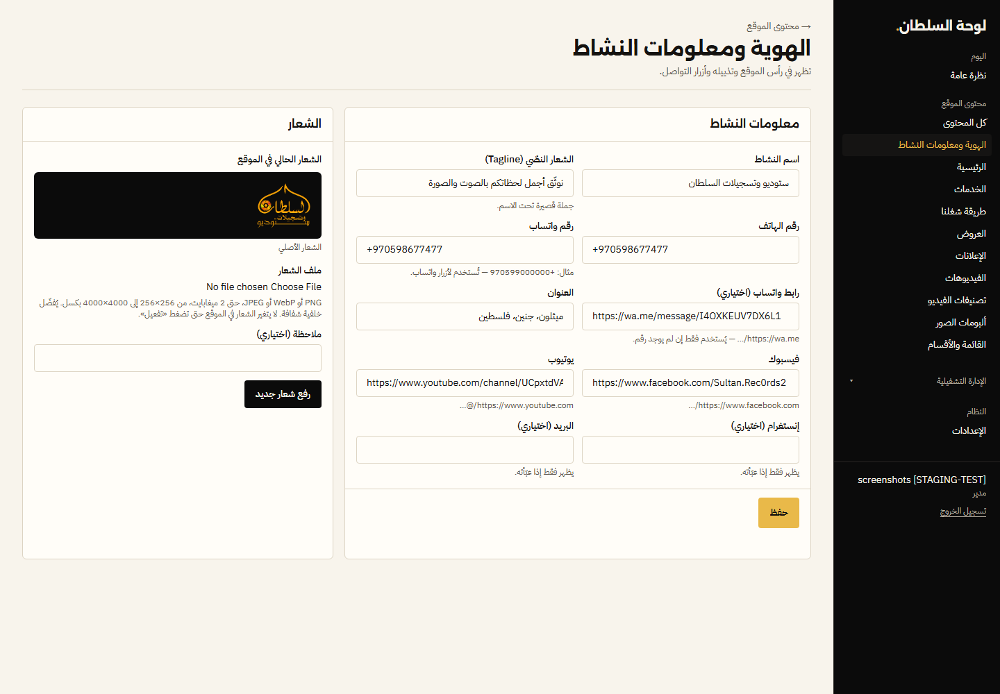

**بخطوات:** محتوى الموقع ← الهوية ← عدّل الحقل ← «حفظ» ← افتح الموقع وتأكد (خلال ثوانٍ).

- **محتوى الموقع ← الهوية ومعلومات النشاط**: الاسم، الجملة التعريفية، الهاتف، رقم واتساب ورابطه، العنوان، فيسبوك، يوتيوب (إنستغرام والبريد اختياريان ويظهران فقط إذا عبّيتهم).
- **الشعار**: الشعار الأصلي يبقى هو المستخدم. تقدر ترفع شعارًا جديدًا (PNG/WebP/JPEG حتى 2MB)، تشوف معاينته، وتفعّله لاحقًا، ومعك دائمًا «الرجوع للشعار السابق» و«الشعار الأصلي».
- **محتوى الموقع ← الرئيسية**: العنوان الكبير، الجملة تحته، أسماء الأزرار، رسالة واتساب الافتراضية، صورة الغلاف، ومصدر الفيديو التعريفي (فيديو الموقع أو فيديو يوتيوب دوره «برومو»).

## إضافة خدمة
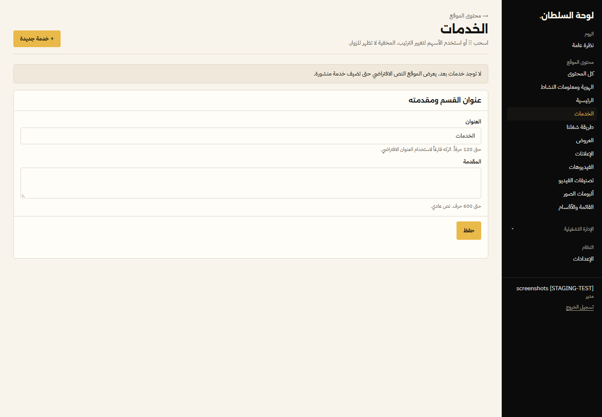

**بخطوات:** الخدمات ← «خدمة جديدة» ← الاسم والوصف ← «معاينة» ← «نشر». للإخفاء: زر «إخفاء» بجانبها في القائمة.

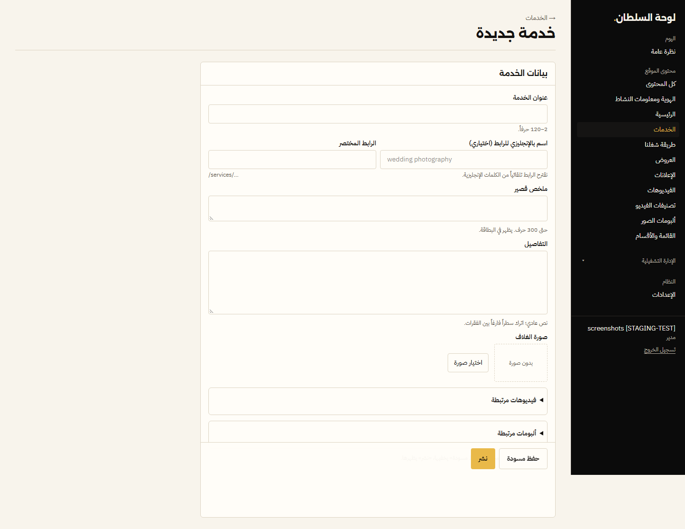

**محتوى الموقع ← الخدمات ← خدمة جديدة**: اكتب الاسم ووصفًا قصيرًا والتفاصيل، اختر صورة غلاف من صور الألبومات، واربط فيديوهات أو ألبومات تمثلها. اضغط «نشر». رتّب الخدمات من القائمة، وأخفِ أي خدمة مؤقتًا بزر «إخفاء». عنوان قسم الخدمات ونصه من نفس الصفحة.
> لا تضيف خدمة لا يقدمها الاستوديو فعليًا.

## «طريقة شغلنا»
**محتوى الموقع ← طريقة شغلنا**: أضف خطوة (عنوان + وصف + صورة اختيارية)، رتّب، أظهر أو أخفِ.

## البكجات (باقات ثابتة)
البكج = باقة خدمات دائمة (بدون تاريخ انتهاء). العرض = شي مؤقت له فترة. القسمين منفصلين ولكل واحد صفحة: `/packages` و`/offers`.

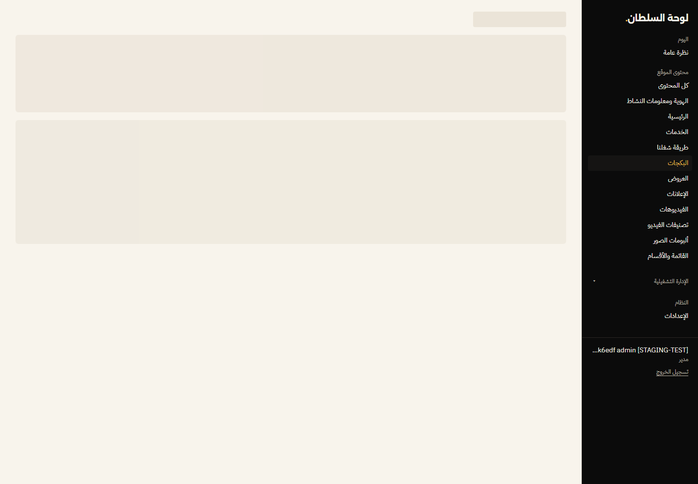

**بخطوات:** محتوى الموقع ← البكجات ← «بكج جديد» ← الاسم، الوصف، الخدمات المشمولة (سطر لكل خدمة)، السعر (اختياري — يظهر فقط مع «إظهار السعر»)، الصورة ← «نشر».
- «تمييز» يعطي البكج إطارًا ذهبيًا وشارة «مميّز». الترتيب بالسحب أو ↑ ↓. «إخفاء» يشيله من الموقع بدون حذف.
- زر واتساب بالبكج يكتب تلقائيًا: «مرحباً، بدي أستفسر عن بكج: <اسم البكج>» (أو رسالتك إذا كتبتها).
- لا تضيف بكج أو سعر غير حقيقي.

## إضافة عرض
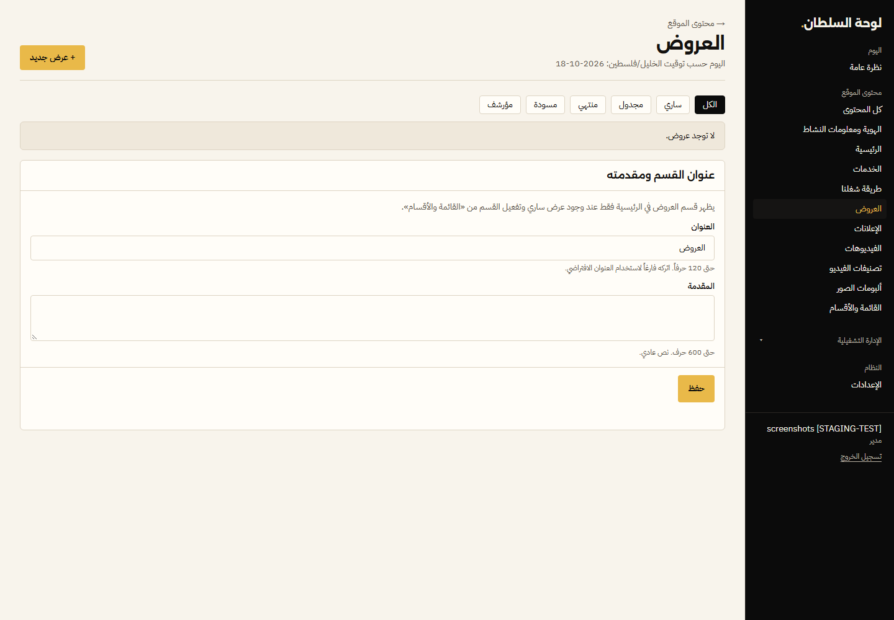

**بخطوات:** العروض ← «عرض جديد» ← العنوان والبنود ← (السعر وتاريخ النهاية اختياريان) ← «معاينة» ← «نشر». بعد النشر يصير الزر «حفظ (منشور)». لإيقافه قبل موعده: «أرشفة».

| كمبيوتر | جوال |
|---|---|
| 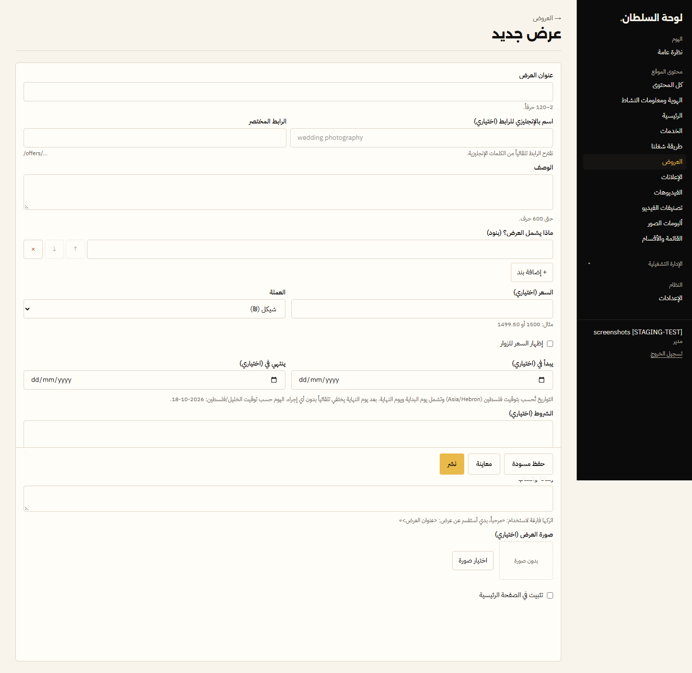 | 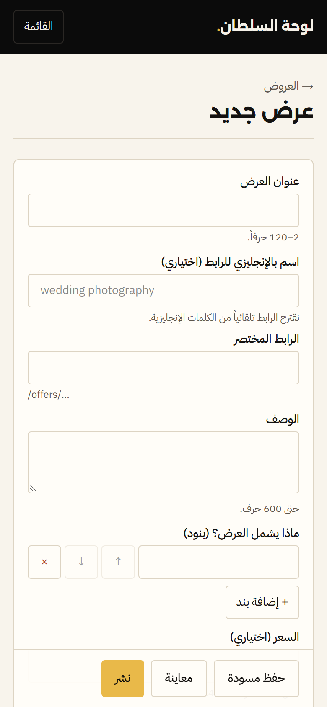 |

**محتوى الموقع ← العروض ← عرض جديد**:
1. الاسم، الوصف، صورة الإعلان، البنود المشمولة.
2. السعر اختياري — ويظهر فقط إذا فعّلت «إظهار السعر».
3. تاريخ البداية والنهاية اختياريان (بتوقيت فلسطين). العرض يختفي **تلقائيًا** بعد آخر يوم، بدون ما تعمل شي.
4. الشروط، ورسالة واتساب (افتراضيًا: «مرحباً، بدي أستفسر عن عرض: …»).
5. **الشهر والسنة المستهدفان** (اختياري): هم اللي بيحددوا الترتيب — عرض تشرين الأول 2026 بيطلع فوق عرض أيلول 2026، و2027 فوق 2026. الموقع **ما بيقرأ الشهر من العنوان**.
6. **مرتبط ببكج** (اختياري): بيظهر «على بكج: …» مع رابط للبكج. تعديل العرض أو انتهاؤه **ما بيغيّر البكج**.
7. «معاينة» ثم «نشر». «تثبيت» يخلّيه أول القائمة (والمثبّتة بينها بترتيب السحب).

ترتيب العروض بالموقع: المثبّتة أولاً ← السارية حسب الشهر المستهدف (الأحدث أولاً) ← البقية. العرض المستقبلي ما بيظهر قبل تاريخ بدايته، والمنتهي بيختفي من الموقع ويضل محفوظ هون بحالة «منتهي».

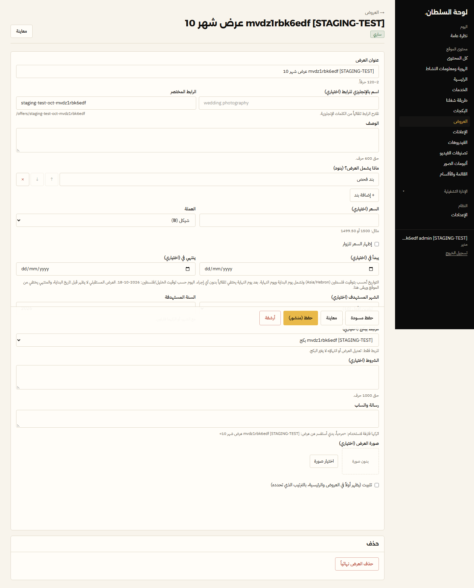
الحالة تظهر بجانب كل عرض: ساري / مجدول / منتهي / مسودة / مؤرشف.

## شريط الإعلان
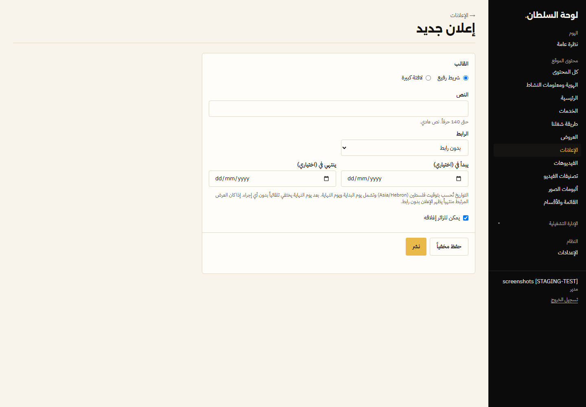

**بخطوات:** الإعلانات ← «إعلان جديد» ← النص ← الرابط (عرض أو صفحة) ← التواريخ ← «نشر». لإيقافه: «إخفاء».

**محتوى الموقع ← الإعلانات**: نص قصير، شكل «شريط» أو «بانر»، رابط لعرض أو لصفحة من صفحات الموقع، تاريخ بداية ونهاية. الزائر يقدر يسكّره.

## إضافة فيديو
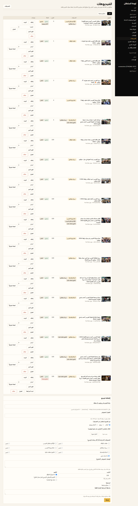

**محتوى الموقع ← الفيديوهات**: الصق رابط يوتيوب (أي شكل: watch أو youtu.be أو shorts). العنوان الأصلي من يوتيوب يُحفظ؛ لو عدّلته يصير «عنوان يدوي» ومعك زر «استعادة عنوان YouTube».
- **التصنيف** = نوع المناسبة (زفاف، سهرة، زفة…).
- **الدور** = أين يظهر: «أعمال» أو «برومو» أو «كلاهما».
- «تثبيت» يخلّيه أول القائمة. «إخفاء» يشيله من الموقع بدون حذف.
> مهم: الفيديوهات تُعرض من يوتيوب. إذا انحذف الفيديو من القناة ما بيشتغل بالموقع. رابط يوتيوب **ليس نسخة احتياطية** للفيديو الأصلي — احتفظ بملفات الفيديو الأصلية عندك.

## إضافة ألبوم صور
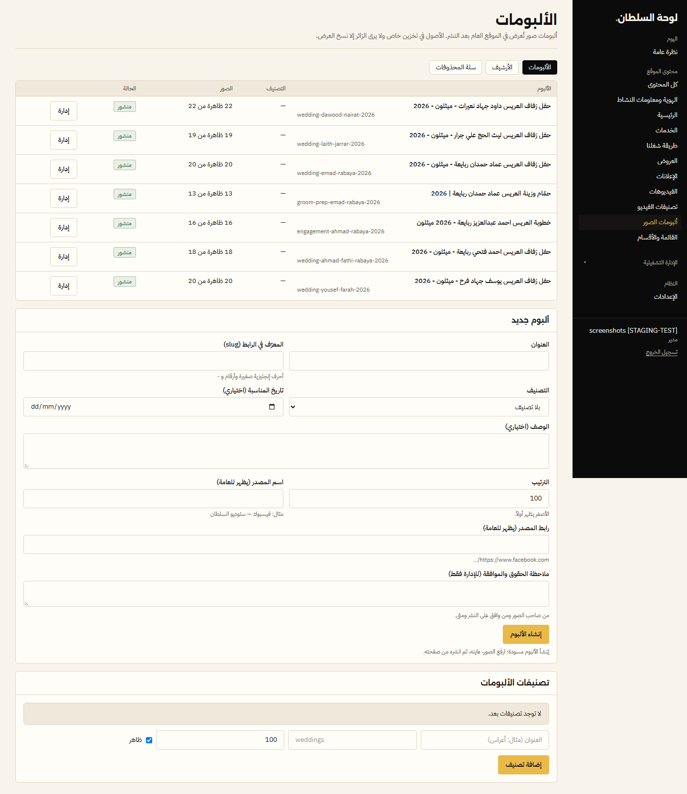

**بخطوات:** ألبومات الصور ← عبّي «ألبوم جديد» ← «إنشاء الألبوم» (ينشأ مسودة) ← «إدارة» ← ارفع الصور ← اختر الغلاف ← «معاينة» ← «نشر».

**محتوى الموقع ← ألبومات الصور ← ألبوم جديد**: الاسم والوصف والتاريخ (اختياري) والتصنيف والمصدر. بعدها:
1. ارفع الصور دفعة وحدة (JPEG/PNG/WebP، حتى 25MB للصورة). كل صورة تظهر حالتها: بانتظار / قيد المعالجة / جاهز / فشل.
2. المعالجة تتم على السيرفر — تقدر تسكّر الصفحة وتكمل لحالها. اللي يفشل، اضغط «إعادة المحاولة».
3. الصور المكررة تنكشف تلقائيًا ولا تنرفع مرتين.
4. اختر الغلاف، رتّب الصور، «معاينة» ثم «نشر».
- **أرشفة**: يخفيه ويحفظه. **سلة المحذوفات**: تقدر ترجّعه. **حذف نهائي**: لازم تكتب اسم الألبوم (slug) للتأكيد، ولا يمكن التراجع.
- الصور الأصلية تبقى خاصة دائمًا؛ الزائر يشوف نسخ العرض فقط.

## القائمة وأقسام الرئيسية
| كمبيوتر | جوال |
|---|---|
| 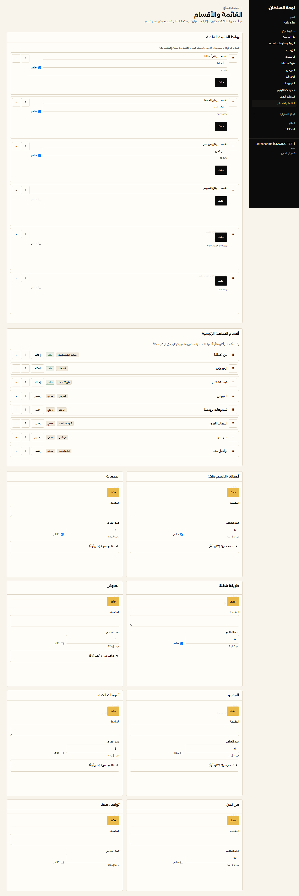 | 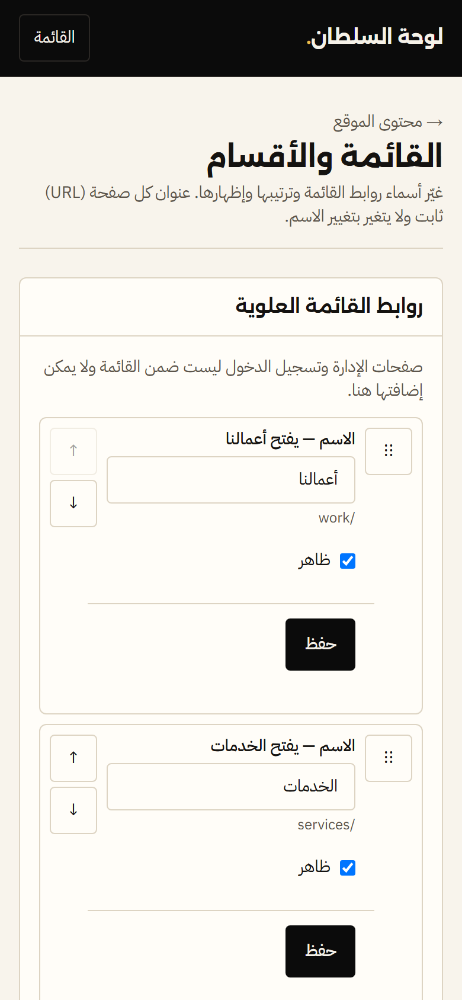 |

**بخطوات:** القائمة والأقسام ← غيّر الاسم أو علامة «ظاهر» ← «حفظ» بنفس الصف. على الجوال: زر «القائمة» فوق يفتح أقسام اللوحة.

**محتوى الموقع ← القائمة والأقسام**:
- غيّر أسماء عناصر القائمة ورتّبها وأظهر/أخفِ أيًا منها — **الروابط نفسها ما بتتغير**.
- رتّب أقسام الرئيسية (أعمالنا، الخدمات، العروض، البروموهات، الألبومات، طريقة شغلنا، من نحن، تواصل معنا)، عدّل عنوان كل قسم ونصه، وعدد العناصر (1–12)، واختر عناصر مميزة.
- القسم الفاضي ما بيظهر للزوار.
- لو غيّرت رابط (slug) خدمة أو عرض أو ألبوم، الرابط القديم بيحوّل تلقائيًا للجديد.

## النسخ الاحتياطي
- **أمر واحد** (على الكمبيوتر، داخل مجلد `web`): `npm run backup` ← ينشئ مجلدًا مؤرخًا `web/backups-local/sultan-backup-<التاريخ>` ويتحقق منه؛ لازم آخر نتيجة تكون `RESULT: COMPLETE`. انسخ المجلد لقرص خارجي. المجلد فيه بيانات خاصة: لا تشاركه ولا ترفعه على Git.
- هذا **ليس نسخًا دوريًا خارجيًا** — لازم تعمله بنفسك دوريًا لحد ما نحدد وجهة ونفعّل الجدولة.
- فقدت كلمة المرور أو جوال المصادقة؟ راجع `docs/owner-access-recovery.md`.

- الصور محفوظة على تخزين الموقع نفسه، **ولا تعتمد على فيسبوك** — حتى لو انحذفت الصفحة، الصور باقية.
- لكن وجودها على Supabase وحده ليس نسخة مستقلة. خذ نسخة كاملة دوريًا (شهريًا مثلًا) على قرص خارجي أو مجلد سحابي تملكه — الخطوات في `docs/backup-restore.md` («Procedure C»). تحتاج جهاز الكمبيوتر مع ملف الإعدادات الخاص بالمشروع.
