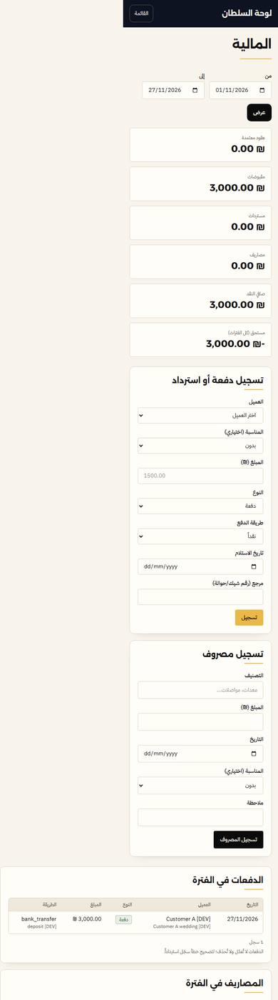
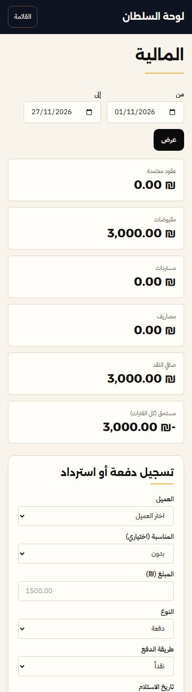
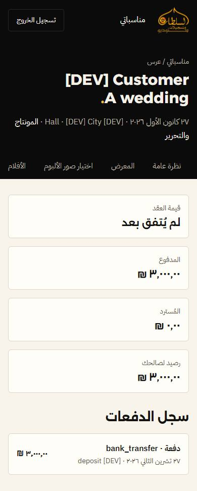
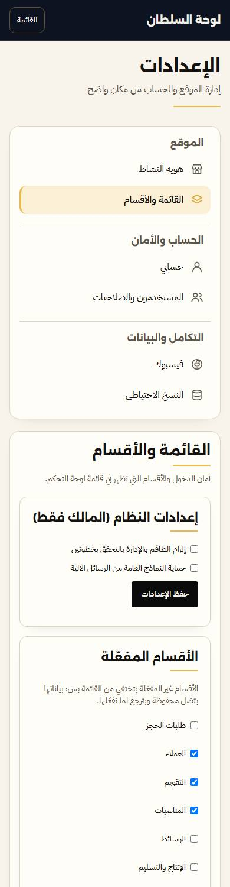
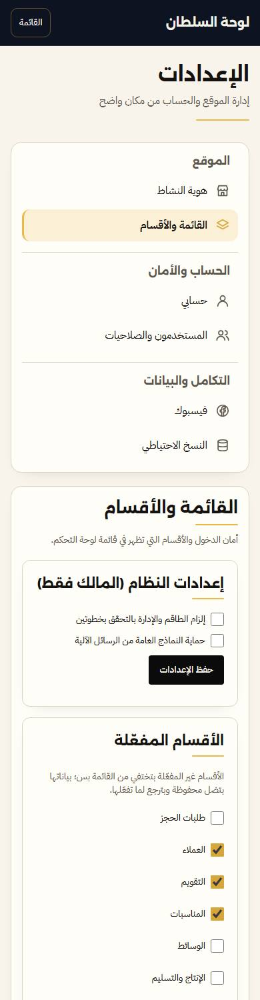
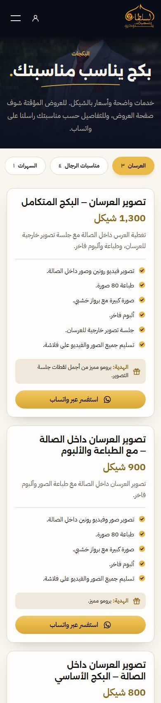

# تدقيق الواجهة وتجربة الاستخدام — Frontend UX/QA Audit

التاريخ: 2026-11-27 · الفرع: `fix/frontend-ux-audit` (من `master` عند `b69081a`)
البيئة: الـstack المعزول `alsultan-home` (API 56321، DB 56322) بعد `e2e-reset-local`، ونسخة Production build عبر `next start -p 3401`. البيانات بيانات seed فقط ([DEV])، ولا توجد بيانات عملاء حقيقية في أي لقطة.

## المنهجية

- مسح آلي جديد في `web/tests/e2e/ux-audit.spec.ts` يغطي **48 مسارًا × 4 عروض (360 / 390 / 768 / 1440) = 192 فحصًا**:
  - **الموقع العام:** الرئيسية، أعمالنا، العروض، تفاصيل عرض، البكجات، من نحن، الحجز، تواصل، الأسئلة، الخصوصية، الشروط، track، تسجيل الدخول، صفحة 404.
  - **لوحة الإدارة** (بحساب المالك): 25 شاشة.
  - **بوابة العميل** (بحساب العميل A): 9 شاشات.
- يسجّل المسح لكل صفحة:
  - أخطاء console والطلبات الفاشلة؛
  - التمرير الأفقي؛
  - الصور المكسورة، والصور بلا alt، والصور تحت الطيّة غير الكسولة؛
  - نتائج axe-core حسب WCAG 2.2 AA؛
  - أهداف اللمس الأصغر من 24px؛
  - لقطة شاشة للصفحة كاملة.
- مراجعة يدوية للّقطات عبر أوراق مقارنة لكل مجموعة: عام، إدارة، بوابة؛ هاتف وسطح مكتب.
- الأداء: Lighthouse غير مثبّت في المشروع، فاستُخدم بديل مكافئ هو Playwright مع CDP. القياس على هاتف 390px، ومعالج أبطأ 4 مرات، وشبكة ‎~1.6Mbps بزمن تأخير 150ms. القيم المقاسة: FCP وLCP وCLS وحجم النقل.
- الحوارات (dialogs): مراجعة الكود، بالإضافة إلى المواصفات الموجودة `a11y-manual` و`qa-responsive`، وهي تفحص التنقل بلوحة المفاتيح، وحصر التركيز داخل الحوار، وإرجاعه بعد الإغلاق.

## النتيجة العامة

الموقع في حالة جيدة.

- لا توجد أخطاء console ولا طلبات فاشلة. الاستثناء الوحيد هو 404 متوقَّع لصفحة غير موجودة.
- لا توجد صور مكسورة، ولا صور بلا alt.
- لا يوجد CLS ملحوظ، وأعلى قيمة 0.026.
- قيم LCP على الهاتف المُبطّأ:

  | الصفحة | LCP |
  |---|---|
  | البكجات | 0.74 ث |
  | الرئيسية | 1.0 ث |
  | أعمالنا | 1.2 ث |

- الحوارات في المنتصف: `<dialog>` أصلي مع `m-auto`، ويُغلق بـEsc، ويرجع التركيز إلى الزر الذي فتحه.
- هوية الكحلي والذهبي متّسقة بين الصفحات العامة والإدارة والبوابة.

المشاكل المؤكَّدة قليلة ومحددة:

| # | الصفحة / الحالة | المشكلة وسببها | الأثر على المستخدم | الأولوية | الإصلاح |
|---|---|---|---|---|---|
| UX1a | الإدارة ← المالية، هاتف 360/390 | جدول «الدفعات في الفترة» عرضه الأدنى 640px. البطاقة عنصر داخل grid وقيمة `min-width` فيها auto، فيتمدد مسار الـgrid بعرض الجدول. | الصفحة كلها تتمرر أفقيًا (340px زائدة)، وكل المحتوى يصغر وينزاح. | عالية | `min-w-0` على `Card` المشترك في `features/admin/ui.tsx`. صار الجدول يتمرر داخل صندوقه فقط، والإصلاح يشمل كل بطاقات الإدارة. |
| UX1b | البوابة ← الأفلام، هاتف | `li` داخل grid بلا `min-w-0`، فلا يعمل `truncate` على عنوان الفيلم، والبطاقة أعرض من الشاشة. | تمرير أفقي في صفحة العميل (49–79px). | عالية | `min-w-0` على عنصر القائمة. |
| UX2 | البوابة ← الدفعات، والإدارة ← المالية | طريقة الدفع تُعرض بقيمتها الخام من قاعدة البيانات، مثل `bank_transfer`. | نص إنجليزي تقني يظهر للعميل في صفحة عربية. | متوسطة | `paymentMethodLabel()` بنفس عبارات نموذج الإدارة (تحويل بنكي، نقداً…). القيم غير المعروفة تُعرض كما هي. |
| UX3 | الإدارة ← التقويم، 1440 | `aria-label` على رابط اليوم يُخفي عنوان المناسبة الظاهر (axe serious: label-content-name-mismatch، WCAG 2.5.3). | من يستخدم التحكم الصوتي لا يستطيع نطق النص الظاهر لفتح اليوم. | متوسطة | حُذف `aria-label` وأُضيف نص `sr-only` بعد رقم اليوم، فصار الاسم المقروء يبدأ بالنص الظاهر. |
| UX4 | الإعدادات، الواجهة، الطاقم، المناسبة، اختيار الصور | مربعات الاختيار والراديو بحجمها الافتراضي 13×13px. | هدف لمس صغير جدًا على الهاتف. | متوسطة | قاعدة base في `globals.css`: الحجم 20×20px ولون `accent-color` من توكن `gold-press`. المربعات كلها داخل `<label>` قابل للنقر، فالهدف الفعلي أكبر. |
| UX5 | البكجات ← سطر «الهدية» | لون `gold-text` على `cream-2` بتباين 4.36:1، والمطلوب 4.5:1 على الأقل. اكتشفه فحص التباين الموجود في `qa-responsive`. | نص صغير أضعف من حد AA. | منخفضة | الكلمة «الهدية:» صارت بلون `on-cream`، وأيقونة الهدية تبقى ذهبية. |

## لقطات قبل / بعد

كل اللقطات على عرض 390px، وهي في `docs/screenshots/frontend-ux-audit/`:

| الحالة | قبل | بعد |
|---|---|---|
| المالية (UX1a) |  |  |
| أفلام البوابة (UX1b) |  |  |
| دفعات البوابة (UX2) |  |  |
| الإعدادات (UX4) |  |  |
| البكجات (UX5) |  |  |

## ملاحظات لم تُعدَّل، وسبب ذلك

- **أعمالنا على الهاتف:** أول 3 صور مصغّرة من YouTube عليها `priority`، والثالثة تقع تحت الطيّة على عرض 390. التكلفة صورة واحدة بحجم ‎~20KB. على سطح المكتب الصور الثلاث في الصف الأول، وتقليلها قد يؤخر LCP هناك، لذلك تُرك الإعداد كما هو.
- **صفحة 404:** بلا ترويسة ولا تذييل، لأنها `not-found` على مستوى الجذر. فيها رابطان واضحان («الرئيسية» و«أعمالنا»)، وتغيير تصميمها خارج النطاق.
- **أرقام البوابة:** البوابة تعرض الأرقام بالأرقام العربية الهندية (٣٬٠٠٠)، والإدارة بالأرقام اللاتينية. هذا قرار قائم ومتّسق داخل كل قسم، فلم يُغيَّر.
- **صورة الترويسة:** صورة خلفية الترويسة (‎~144KB) تُحمَّل في كل صفحة عامة، وهي أكبر ملف في كل صفحة. الأداء مقبول. ضغطها أكثر يحتاج قرارًا حول جودة صورة حقيقية من الاستوديو، فلم تُمس.
- **ما ليس خطأ:** `/track` تحويل مقصود إلى `/book`. والرابط `/work/wedding` الذي أعاد 404 أثناء المسح كان خطأً في عنوان الاختبار نفسه، لأن `/work/[slug]` صفحة مشروع وليست تصنيفًا.

## ما لم يُفحص فعليًا

- **WebKit / Safari:** تشغيله في هذا المشروع اختياري (`PW_WEBKIT=1`)، ولم يُشغَّل في هذه الجولة.
- **صلاحيات staff وadmin:** المسح الشامل جرى بحساب المالك. هذان الدوران مغطّيان في المواصفات الموجودة (`admin-nav` و`qa-admin`)، ولم يُلتقط لهما مسح بصري منفصل.
- **الحالات الثقيلة:** ألبومات بأكثر من 1000 صورة، ورفع حقيقي، وتشغيل YouTube، لم تُفحص بصريًا في هذه الجولة. لها مواصفات خاصة لم تُشغَّل هنا: `album-over-1000` و`album-upload-*`.
- **Lighthouse نفسه:** غير مثبّت، ولم أُضِف dependency جديدة لأجله. استُخدم البديل المذكور في قسم المنهجية.

## إضافة: جولة ثانية (Lighthouse وقبل/بعد على build منفصل)

البيئة نفسها (`alsultan-home`، seed فقط). «قبل» = worktree نظيف عند `b69081a` على `next start -p 3400`، و«بعد» = هذا الفرع على 3401. شُغّل المسح `ux-audit` على الاثنين (196 / 200 تحميل صفحة).

| المقياس | قبل | بعد |
|---|---|---|
| صفحات فيها تمرير أفقي | 4 (المالية 360/390، أفلام البوابة 360/390) | 0 |
| نتائج axe | 1 (التقويم) | 0 |
| صور مكسورة | 0 | 0 |

### إصلاح إضافي

| # | الصفحة | المشكلة | الإصلاح |
|---|---|---|---|
| UX6 | البوابة ← الأفلام، 360 | بعد UX1b صار العنوان الإنجليزي يُقصّ من **بدايته** («…ing highlight film») لأن `truncate` على عنصر RTL | `dir` حسب لغة العنوان على العنصر الذي يُقصّ نفسه، فيُقصّ من نهايته («[DEV] Wedding hi…») |

### Lighthouse 12.8.2 (عبر `npx`، لم يُضف للمشروع)

هاتف، throttling محاكى، Chrome headless، الجهاز نفسه. شُغّل أثناء تشغيل مسح Playwright، فالفرق ±3–5 نقاط أداء ضجيج قياس.

| الصفحة | الأداء قبل ← بعد | الوصول | الممارسات | SEO | LCP قبل ← بعد | CLS |
|---|---|---|---|---|---|---|
| `/` | 78 ← 76 | 100 | 100 | 100 | 6.0 ← 6.0 ث | 0 |
| `/work` | 74 ← 77 | 100 | 100 | 100 | 6.3 ← 5.6 ث | 0 |
| `/packages` | 77 ← 78 | 100 | 100 | 100 | 5.8 ← 5.8 ث | 0 |
| `/login` | 90 ← 88 | 100 | 100 | 66 (noindex مقصود) | 3.7 ← 3.8 ث | 0 |

- **UX7 (مفتوح، قرار للمالك):** عنصر LCP هو صورة الترويسة. تُحمَّل في أقل من 0.8 ث، لكن Lighthouse يسجّل **≈5 ث render delay** قبل رسمها، والسبب الأرجح حركة الافتتاح المعتمدة في الترويسة. هذا يفسّر الفرق مع قياس CDP أعلاه (0.7–1.2 ث) الذي لا يحتسب الحركة بنفس الطريقة. تقصيرها تغيير تصميم، فلم يُمسّ.
- **Chrome DevTools MCP:** غير مثبّت. التثبيت يحتاج `/plugin` تفاعليًا، وهو غير متاح في هذه الجلسة. console والشبكة سُجّلا عبر Playwright.
